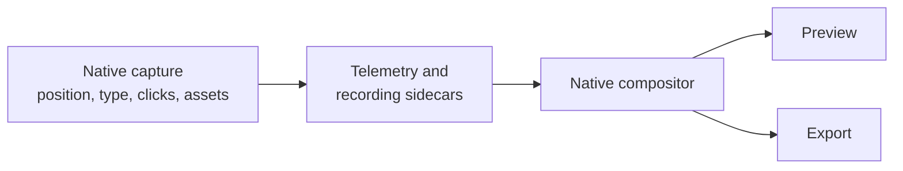

# Cursor pipeline

The cursor feature records system-cursor position and, where the native provider is available, cursor assets separately from the screen video, then re-renders the cursor as a themed, smoothed sprite instead of baking it into the capture. Its shared smoothing and asset code lives in `src/lib/cursor/`; native capture and IPC adapters live under `electron/native/` and `electron/native-bridge/cursor/`; the native compositor draws it (`crates/compositor/src/cursor.rs`).

## Capture

Native capture keeps cursor data separate from the video frame. On Windows, the WGC cursor sampler in `electron/native/wgc-capture/src/cursor-sampler.cpp` samples the system cursor during desktop duplication and records its position, hotspot, bitmap, and cursor type. On macOS, the ScreenCaptureKit cursor helper at `electron/native/screencapturekit/Sources/OpenScreenMacOSCursorHelper/main.swift` samples the current system cursor, emits unique bitmap assets, and records cursor samples plus left-button interaction events. The recording sessions under `electron/native-bridge/cursor/recording/` select and wrap the platform provider; `telemetryCursorAdapter.ts` provides the position-only fallback when native assets are unavailable. The resulting contracts are `CursorRecordingData` and `CursorRecordingSample` in `src/native/contracts.ts`.

## Telemetry

Position telemetry is represented by `CursorTelemetryPoint` in `src/lib/cursorTelemetryBuffer.ts`. Each point contains `timeMs`, the offset from recording start, and `cx`/`cy`, clamped ratios of the captured surface (`cursorTelemetryBuffer.ts:1-10`). The main-process `CursorTelemetryBuffer` starts a session with a recording id, appends samples, and finalizes them into FIFO batches keyed by that id (`cursorTelemetryBuffer.ts:25-34`). This key keeps asynchronous persistence and discard operations associated with the correct recording. Native cursor samples use the same recording-time convention, and `CursorTrack::load` in `crates/compositor/src/cursor.rs` loads a selected window by subtracting its offset so the first sample is at time zero.

On Windows the video's 0 s is its first frame, and the sampler's clock is shifted onto it (`shiftCursorTelemetry`). The shift is the first frame's own wall-clock time, which `wgc-capture` derives from the frame's WGC timestamp and prints in `recording-started` (`firstFrameEpochMs`), minus the sampler's start (`cursorOffsetToFirstFrameMs` in `electron/recording/nativeWindowsCaptureStop.ts`). The time the app read that line is only the fallback for an older helper: it comes 10 to 30 ms after the frame, more under load, and drew the cursor that much ahead of the picture.

Between two samples the Windows sampler also writes where the pointer is, every quarter of the sample interval (8.25 ms) and only when it moved (`move` events). They become the sidecar's optional `path`, `[timeMs, cx, cy]` triplets the compositor merges into the track it draws, so a fast flick follows a 121 Hz path instead of 30 Hz straight segments. The samples keep their ~30 Hz cadence, which the auto-zoom planner's speed thresholds assume; the path is positions only.

## Input signals (Windows)

Besides the 33 ms position ticks, the Windows sampler writes what the user did, each at the moment and point the hook stamped (`MSLLHOOKSTRUCT` / `KBDLLHOOKSTRUCT`), not at the next tick: presses and releases of the left, right and middle buttons (double clicks by the system's own settings), wheel notches, key-downs, and popup or menu windows opening and closing (WinEvents, with their bounds). At each press, UI Automation adds the bounds and control type of the element under the pointer. The recording session turns each into a cursor sample of its own carrying an `input` field (`CursorInputSignal`, `src/lib/cursor/inputSignals.ts`), so the sidecar keeps one format and older readers see ordinary samples. The auto-zoom planner reads them (typing holds, popup framing); the shortcut chords are kept for on-screen shortcuts.

Privacy is enforced in the sampler (`input_signals.cpp`): a key-down is a time only. A key is named only inside a chord holding Ctrl, Alt or Win ("Ctrl+K"), never for a plain key, Shift+key or AltGr (which types characters on most non-US layouts). UI Automation contributes bounds and a control type, never an element's name or value. A window capture's bounds come from `DWMWA_EXTENDED_FRAME_BOUNDS`, which excludes the invisible resize borders `GetWindowRect` counts.

## Rendering

The native compositor draws the cursor in the preview and in the export alike. There is no preview overlay: the recorded cursor is part of the composited frame, read from the same cursor sidecar the export uses. The compositor in `crates/compositor/src/cursor.rs` interpolates the raw samples (and the fine `path`), smooths them (`CursorTrack::smoothed`), and computes click-bounce timing. The smoothing is zero-phase: the whole path is known, so each point is the centred Gaussian average of the path around it on a 240 Hz grid, with a spread of 30 ms times the Smoothing slider (default 0.3, 9 ms). A pointer at any steady speed is drawn where it is, when it is there; only tremor and the corners of the sampled path are rounded off. Each click is pulled back onto its raw point at its instant, so the drawn cursor sits on the clicked pixel. The spring it replaced trailed the pointer by its damping over its stiffness, 189 ms at the old default of 0.67. `src/lib/cursor/cursorPathSmoothing.ts` mirrors it in TypeScript. Preview and export therefore consume the same telemetry and cursor rules rather than maintaining independent cursor tracks.

Three optional layers sit on the cursor, all drawn by the compositor in the preview and the export alike:

- **Click ring** (`cursor.clickRing`, editor setting `cursorClickRing`): an expanding ring at each click, laid on an identity plane so it stays round under the 3D camera (`click_ring` in `SceneCursor`, extent `CLICK_RING_EXTENT`). On in new projects. The older *click impact* effect (shader mode 16) is a separate setting and stays off.
- **Spotlight** (`cursor.spotlight`, `cursorSpotlight`): the whole frame dimmed outside a soft disc on the smoothed pointer (`spotlight_cb`, shader mode 20 — 19 is Glass Lens — drawn first so the rings sit on top). Off by default. **Direct3D 11 only**: the Metal and wgpu shaders have no spotlight mode, so `frame_geometry.rs` emits it only under `cfg!(target_os = "windows")`.
- **Shortcut plates** (`cursorShowKeystrokes`): the chords the Windows sampler named (Ctrl/Alt/Win + key; see Input signals) become text plates at the bottom of the frame. `keystrokes.ts` reads them at import (`keystrokesFromCursorSamples`, kept free of `@/` imports because the main process loads it) into `asset.keystrokes`; `keystrokeRegions.ts` turns them into text regions in `buildSceneDescription`. On in new projects.

A crash-safe copy of the samples is kept while recording: `CursorCheckpointWriter` (`electron/recording/cursorCheckpoint.ts`) appends them to `<take>.mp4.cursor.ndjson` every 5 s, and a take recovered at launch rebuilds its telemetry from that file. If the sampler process dies, the session restarts it up to `MAX_HELPER_RESTARTS` (5) times, 500 ms apart (`windowsNativeRecordingSession.ts`); after that it only logs `restart-gave-up` — the app does not tell the user yet.

Glass cursors read the picture under them. When the cursor is the Prism Glow crystal or Glass Lens (`CursorPlan::glass`), each backend copies the frame as composed so far, footage and privacy blurs included, just before drawing the cursor, and the shader refracts that copy. Glass Lens does this with the 3D option off as well: its sprite names a glass model (`glass` in `cursorSprites`), and mode 19 (`cursor_glass_cb`) draws that model face on instead of the PNG, which only serves the theme picker.

## Settings

The cursor settings pane is `CursorPane` in `src/components/ai-edition/RightPanes.tsx`; the current v4 inspector exposes it through the cursor facet in `src/components/ai-edition/v4/FloatingInspector.tsx:57-63,1073`. It controls showing the cursor, clipping it to the canvas, theme, size, smoothing, motion blur, and click bounce. `RightPanes.tsx:1592-1692` binds those controls to editor settings and forwards the rendering parameters to the native compositor. Preview and export both render through that compositor, so a change shows in both.

## Auto-follow

Cursor telemetry also drives camera focus for auto-follow zooms. `src/lib/zoomMath/cursorFollowUtils.ts` interpolates the cursor at content time and applies distance-adaptive, frame-rate-independent smoothing. The zoom-region utilities use that focus for preview, while the export frame renderer uses the corresponding focus during export. The native compositor keeps a raw track for cursor placement and derives a separately smoothed follow track (`crates/compositor/src/cursor.rs:16-24,126-136`), preventing camera motion from changing the cursor's actual recorded position.

## Bundled assets

No themed cursor pack ships today. The packs that used to sit under `public/cursors/<id>/` came from sweezy-cursors.com, whose terms forbid redistributing them, and were removed. A pack added later goes there as arrow and pointer PNGs registered in `CURSOR_THEMES` (`src/lib/cursor/cursorThemes.ts`), under a licence recorded in `THIRD-PARTY-NOTICES.md`; the editor only shows the theme picker once one exists. The built-in native replacement SVG set is under `src/assets/cursors/`; `DEFAULT_CURSOR_SPRITES` in `src/lib/cursor/cursorThemes.ts` maps each captured cursor type to its rasterized asset and hotspot.

The same built-in art also exists as PNGs under `public/cursors/default/`, generated from those SVGs by `scripts/generate-default-cursor-sprites.mjs`. The native compositor decodes png/jpeg from a real path and cannot read the SVGs, which exist only as bundler URLs in the renderer — so without the PNG set it had no default art and drew a placeholder dot-and-ring instead of a pointer. Regenerate rather than hand-editing: the script also emits the `DEFAULT_CURSOR_SPRITES` hotspot table, which would otherwise drift from the images.

## Sprite selection and the hotspot

`resolveCursorSprites` (`cursorThemes.ts`) resolves one sprite per `NativeCursorType`: the selected theme's art where it has any, the built-in art everywhere else. A pack may ship only an arrow and a pointer while a recording walks through a dozen OS states, so this fallback is what keeps a text caret from rendering as an arrow. `resolveSceneAssetPaths` (`compositorViewService.ts`) turns that table into absolute on-disk paths and puts it in the scene as `cursor.cursorSprites`; the compositor picks by the state in the track and falls back to the arrow.

Each sprite carries its hotspot as a **fraction of its own image**, not in pixels. The compositor scales the sprite to the cursor-size setting, so a pixel offset would need rescaling at draw time; a fraction survives any scale. Both renderers anchor on it (`cursor_sprite_dst` in `compositor.rs`, and `renderAsset.hotspot* × scale` in the web paths) — drawing from the sprite's centre instead made an enlarged cursor point further and further from its target.

## Known gaps

macOS single-window capture can report a cursor offset relative to the captured surface. This remains an open platform-specific alignment issue; display capture does not exhibit the same verified gap.
